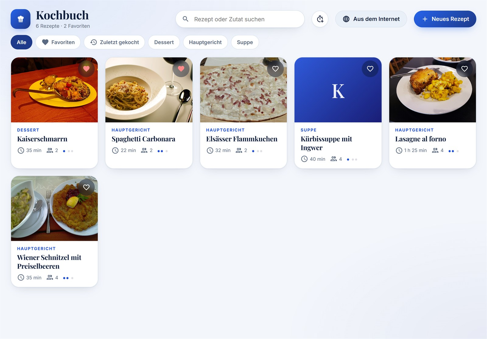
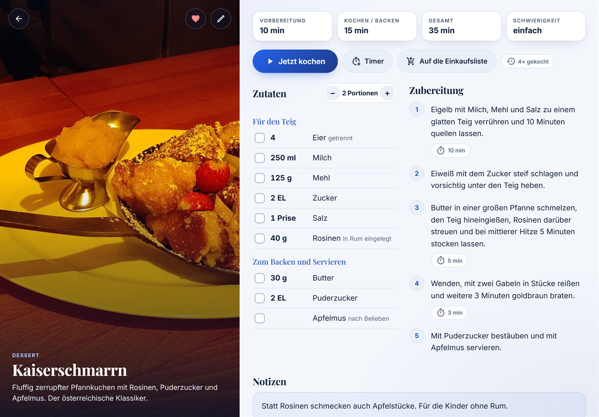
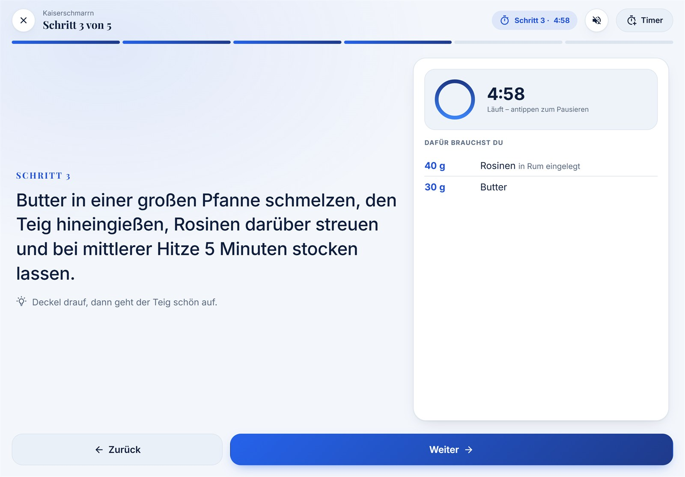
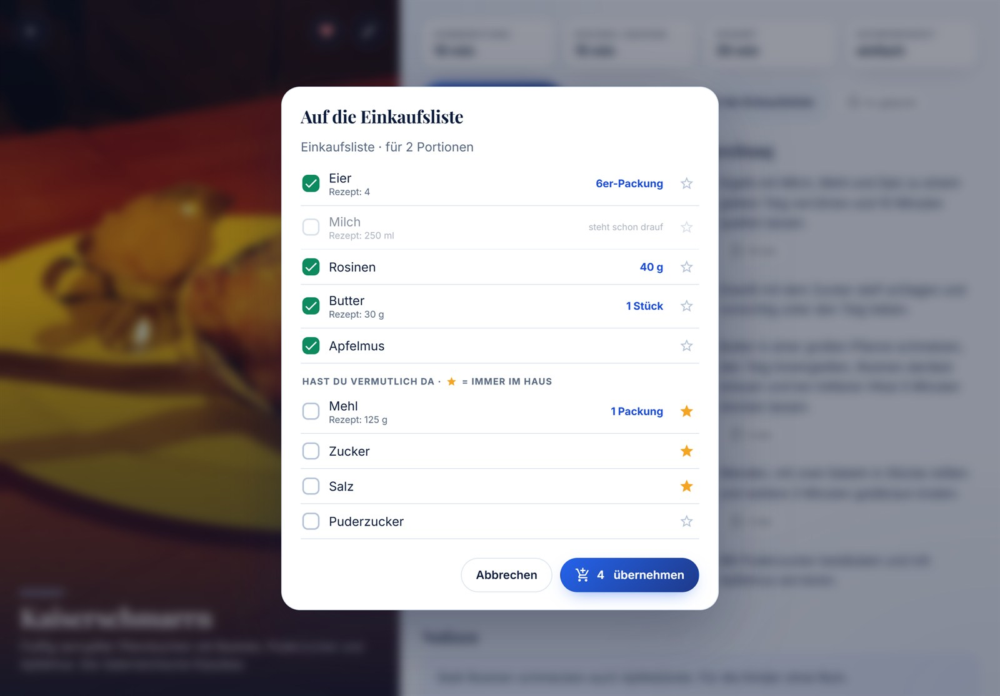
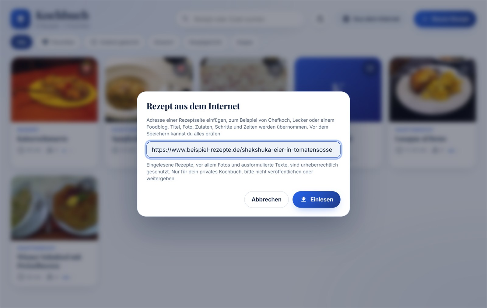
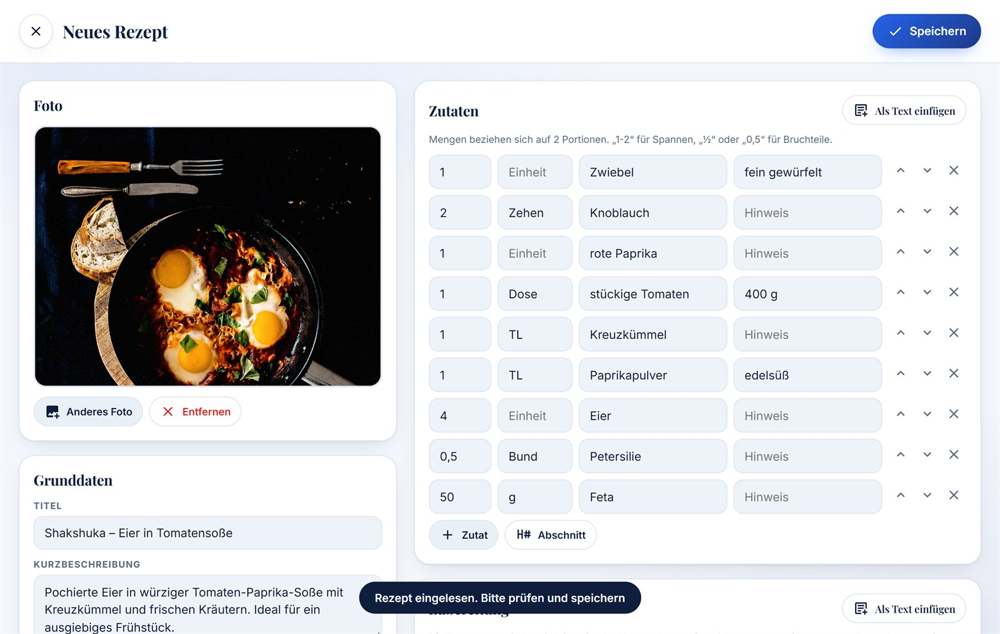
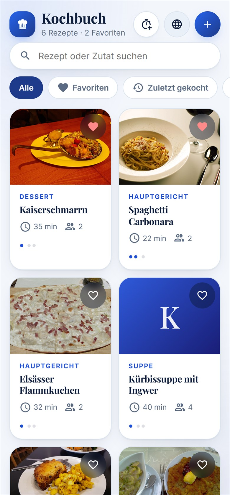
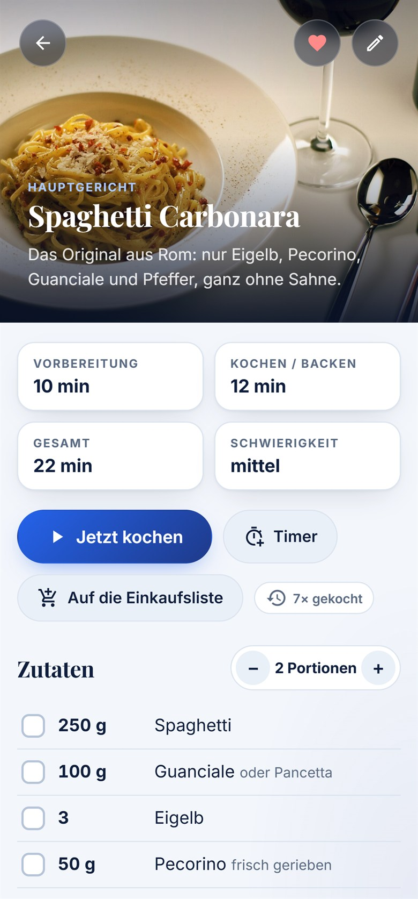

# Kochbuch

**Ein eigenes Kochbuch für Home Assistant.** Rezepte schreiben und bebildern, aus dem Internet einlesen, mit dem Kochmodus Schritt für Schritt nachkochen und Zutaten auf die Einkaufsliste setzen. Komplett deutsch, gemacht für das Küchen-Tablet.

[](https://my.home-assistant.io/redirect/hacs_repository/?owner=msucimaker3112&repository=kochbuch-card&category=plugin)



- **Rezepte** mit Foto, Kategorie, Stichwörtern, Schwierigkeit, Zeiten, Notizen und Favoriten. Suche über Titel, Zutaten und Stichwörter.
- **Aus dem Internet:** Adresse einer Rezeptseite einfügen (Chefkoch, Lecker, Foodblogs …), die Karte füllt den Editor aus. Vor dem Speichern prüfst du alles.
- **Kochmodus:** großer Text, Zutaten je Schritt, Timer mit Ring und Alarm, Temperatur, Wischen oder Pfeiltasten zum Blättern. Der Bildschirm bleibt an.
- **Portionen umrechnen:** Mengen passen sich an, aus „1000 g“ wird „1 kg“.
- **Einkaufsliste, die mitdenkt:** Zutaten auf eine `todo`-Liste setzen (zum Beispiel Bring! oder die Einkaufsliste von Home Assistant), umgerechnet in Packungen („150 ml Sahne“ → „1 Becher“). Was du meistens im Haus hast, und Kleinmengen wie „3 Prisen Pfeffer“ sind nicht vorausgewählt. Was schon draufsteht, wird erkannt.
- **Freie Timer** für Eier, Nudeln, Reis oder eigene Zeiten, auf Wunsch mit Ansage über einen Lautsprecher.
- **Vorlesen und Sprachsteuerung:** Schritte vorlesen lassen, „Alexa, nächster Schritt“ über Routinen.

Rezepte liegen in einem eigenen Dashboard von Home Assistant, Fotos im Bilderspeicher von Home Assistant. Sie sind damit in jedem normalen Backup enthalten. Eine Datenbank oder ein Add-on brauchst du nicht.

## So sieht es aus

**Rezept:** Zeiten und Schwierigkeit auf einen Blick, Zutaten zum Abhaken, Portionen mit − und + umrechnen. Schritte mit Timer zeigen die Dauer gleich mit.



**Kochmodus:** ein Schritt pro Seite in großer Schrift, rechts die Zutaten für genau diesen Schritt und der Timer. Antippen startet ihn, läuft er ab, klingelt die Karte und sagt es auf Wunsch über Alexa an. Weiter geht es per Knopf, Wischen, Pfeiltaste oder „Alexa, nächster Schritt“.



**Einkaufsliste:** Oben steht, was du kaufen musst, gleich in Packungen umgerechnet. Unten steht, was du vermutlich da hast. Was schon auf der Liste steht, ist abgewählt. Mehr dazu unter [Einkaufsliste](#einkaufsliste).



**Rezept aus dem Internet:** Adresse einfügen, „Einlesen“ antippen …



… und der Editor ist ausgefüllt: Foto, Titel, Beschreibung, Zutaten mit Menge, Einheit und Hinweis, darunter die Schritte. Prüfen, speichern, fertig.



**Auf dem Handy** ordnet sich alles untereinander an:

<p>
  
  &nbsp;
  
</p>

*Die Screenshots zeigen Beispielrezepte, Bildnachweise [unten](#bildnachweise).*

## English

**A recipe book card for Home Assistant**, made for the kitchen tablet: recipes with photos, **import from any recipe website** (schema.org data, fetched through a `rest_command`), a **cooking mode** with step timers, swipe navigation and read-aloud via Alexa, **portion scaling**, and a **smart shopping list** for any `todo` entity (Bring!, HA shopping list) that converts amounts into packs and skips pantry items like salt or a pinch of pepper. Recipes are stored in a Home Assistant dashboard and photos in HA's image storage, so they are part of every backup. No add-on or database needed.

**Install:** HACS → ⋮ → *Custom repositories* → `https://github.com/msucimaker3112/kochbuch-card`, category *Dashboard* → download → reload the browser. Then add `type: custom:kochbuch-card` to a panel view (see [Einrichtung](#einrichtung) for the options).

The user interface is **German only** for now. Issues and pull requests in English are welcome.

## Installation

### Über HACS (benutzerdefiniertes Repository)

Am einfachsten über das Abzeichen oben („In HACS öffnen“). Oder von Hand: HACS → ⋮ → *Benutzerdefinierte Repositories* → `https://github.com/msucimaker3112/kochbuch-card`, Kategorie *Dashboard* → herunterladen → Browser neu laden.

HACS trägt die Karte selbst als Dashboard-Ressource ein und meldet Updates.

### Manuell

1. `kochbuch-card.js` nach `/config/www/kochbuch-card.js` kopieren (zum Beispiel mit der App *File editor* oder per Samba).
2. Einstellungen → Dashboards → ⋮ → *Ressourcen* → *Ressource hinzufügen*: URL `/local/kochbuch-card.js?v=0.6.0`, Typ *JavaScript-Modul*.
3. Browser hart neu laden (Strg + Umschalt + R) bzw. in der Companion-App den Frontend-Cache zurücksetzen.

Bei jedem Update die Zahl hinter `?v=` erhöhen, damit Browser und App die neue Datei laden.

## Einrichtung

Am besten ein eigenes Dashboard im Panel-Modus anlegen, damit die Karte die ganze Seite nutzt:

```yaml
views:
  - title: Kochbuch
    path: rezepte
    type: panel
    cards:
      - type: custom:kochbuch-card
        title: Kochbuch
        store: kochbuch-daten
        shopping_list: todo.einkaufsliste
        announce: notify.alexa_media_kueche
```

| Option | Standard | Bedeutung |
|---|---|---|
| `title` | `Kochbuch` | Überschrift auf der Startseite |
| `store` | `kochbuch-daten` | URL-Pfad des Dashboards, in dem die Rezepte gespeichert werden. Wird beim ersten Speichern angelegt, falls es fehlt. Nicht von Hand bearbeiten. |
| `shopping_list` | – | `todo`-Entität für „Auf die Einkaufsliste“. Ohne Angabe gibt es den Knopf nicht. |
| `announce` | – | Dienst für Timer-Ansagen, zum Beispiel `notify.alexa_media_kueche` |
| `speak` | Wert von `announce` | Dienst für das Vorlesen der Schritte |
| `voice` | siehe unten | Schalter oder Knöpfe für die Sprachsteuerung |
| `pantry` | Salz, Pfeffer, Zucker, Öl, Olivenöl, Mehl, Essig | Startliste für „hab ich meistens im Haus“. Sobald du im Einkaufsdialog einen Stern setzt, gilt die im Kochbuch gespeicherte Liste. |

**Speichern geht nur mit einem Administrator-Konto**, weil die Rezepte in einer Dashboard-Konfiguration liegen. Lesen und Kochen geht mit jedem Konto.

## Einkaufsliste

Ein Rezept sagt, wie viel du verbrauchst. Die Einkaufsliste braucht, was du kaufen musst. „Auf die Einkaufsliste“ rechnet deshalb um:

| Im Rezept | Auf der Liste |
|---|---|
| 150 ml Sahne | Sahne · 1 Becher |
| 300 g + 100 g Butter | Butter · 2 Stück |
| 4 Eier, 3 Eigelb | Eier · 10er-Packung |
| 2 Zehen Knoblauch | Knoblauch · 1 Knolle |
| 400 g Karotten | Karotten · 400 g (lose Ware) |
| 3 Prisen Pfeffer, 2 EL Olivenöl | nicht vorausgewählt („hast du vermutlich da“) |
| 500 ml Wasser | gar nicht |

- **Vorrat:** Zutaten aus deiner Vorratsliste und Kleinmengen (Prise, Messerspitze, Spritzer, EL, TL) stehen unten unter „Hast du vermutlich da“ und sind abgewählt. Brauchst du doch etwas, tippst du es an.
- **Stern:** Mit ☆ merkst du dir eine Zutat als „immer im Haus“, mit ★ nimmst du sie wieder heraus. Die Liste wird im Kochbuch gespeichert und gilt auf allen Geräten.
- **Packungen:** Für die häufigsten Zutaten kennt die Karte die üblichen Packungsgrößen (Butter 250 g, Sahne 200 ml, Milch 1 l, Mozzarella 125 g, Hack 500 g, Nudeln 500 g …). Andere Zutaten kommen mit der Rezeptmenge oder nur mit dem Namen auf die Liste.
- Gleiche Zutaten werden zusammengerechnet. Eier, Eigelb und Eiweiß werden zu einer Zeile, getrennte Eier zählen dabei nicht doppelt.

## Rezepte aus dem Internet

Der Knopf **„Aus dem Internet“** (auf schmalen Bildschirmen nur das Globus-Symbol) liest Rezeptseiten ein. Fast alle Rezeptseiten liefern ihre Rezepte zusätzlich als maschinenlesbare Daten ([schema.org/Recipe](https://schema.org/Recipe)) mit. Die Karte übernimmt daraus Titel, Beschreibung, Foto, Portionen, Zeiten, Kategorie, Stichwörter, Zutaten und Schritte. Zeiten wie „20 Minuten“ werden zu Timern, „180 °C“ zur Temperatur des Schritts. Seiten ohne solche Daten liefern nur Titel und Foto. Den Rest fügst du dann mit „Als Text einfügen“ hinzu.

Der Browser darf fremde Webseiten nicht direkt lesen, deshalb ruft **Home Assistant** die Seite ab. Dafür in `configuration.yaml` eintragen:

```yaml
rest_command:
  kochbuch_abruf:
    url: "{{ url }}"
    method: get
    timeout: 20
    headers:
      User-Agent: "Mozilla/5.0 (Windows NT 10.0; Win64; x64) AppleWebKit/537.36 (KHTML, like Gecko) Chrome/130.0 Safari/537.36"
      Accept: "text/html,application/xhtml+xml"
      Accept-Language: "de-DE,de;q=0.9"
```

Danach unter Entwicklerwerkzeuge → YAML die Konfiguration prüfen und *REST-Befehle* neu laden. Ein Neustart ist nicht nötig.

Ohne diesen Dienst versucht die Karte öffentliche Abrufdienste (allorigins.win, codetabs.com). Die sind oft überlastet und bekommen die Adresse des Rezepts zu sehen, sie sind also nur eine Notlösung.

Hinweis: Mit dem Dienst kann jedes Konto in Home Assistant eine beliebige Adresse über Home Assistant abrufen lassen.

### Urheberrecht

Eingelesene Rezepte, vor allem **Fotos** und ausformulierte Texte, sind urheberrechtlich geschützt. Zutatenlisten und das Gericht selbst sind es in der Regel nicht. Die Funktion ist für **dein privates Kochbuch** gedacht, vergleichbar mit Ausdrucken oder Abspeichern der Seite. Veröffentliche eingelesene Rezepte nicht und gib sie nicht weiter. Die Karte speichert die Quelle mit und verlinkt im Rezept auf das Original. Das Import-Fenster zeigt denselben Hinweis.

Das ist keine Rechtsberatung.

## Sprachsteuerung mit Alexa

Die Karte beobachtet drei Helfer. Lege sie als *Schalter* (`input_boolean`) oder *Taste* (`input_button`) an und schalte bzw. drücke sie in Alexa-Routinen:

| Befehl | Standard-Helfer | Wirkung |
|---|---|---|
| `next` | `input_boolean.kochbuch_weiter` | Rezept geöffnet: Kochmodus starten. Im Kochmodus: nächster Schritt |
| `back` | `input_boolean.kochbuch_zuruck` | Schritt zurück |
| `read` | `input_boolean.kochbuch_vorlesen` | aktuellen Schritt bzw. Zutatenliste vorlesen |

Schalter setzt die Karte nach dem Befehl selbst wieder aus. Andere Helfer:

```yaml
voice:
  next: input_button.kochbuch_weiter
  back: input_button.kochbuch_zurueck
  read: input_button.kochbuch_vorlesen
```

Vorgelesen wird über `speak` (sonst `announce`) mit `data: {type: tts}`, passend für Alexa Media Player.

## Daten

- **Rezepte:** im Dashboard `store` unter dem Schlüssel `kochbuch` der Konfiguration. Mehrere Geräte arbeiten auf demselben Stand, jede Änderung liest vorher neu.
- **Fotos:** im Bilderspeicher von Home Assistant (`/api/image`), beim Hochladen auf höchstens 1600 px verkleinert. Ersetzte oder gelöschte Fotos werden mit entfernt.
- **Vorratsliste:** ebenfalls im Dashboard `store`, unter `kochbuch.pantry`.
- **Gerätebezogen** (nur im Browser): zuletzt gewählte Kategorie und ob Schritte automatisch vorgelesen werden.

## Bildnachweise

Die Gerichtsfotos in den Screenshots stammen von Wikimedia Commons und sind gemeinfrei (CC0 oder Public Domain):

| Gericht | Foto | Urheber |
|---|---|---|
| Kaiserschmarrn | [Kaiserschmarrn, Munich.jpg](https://commons.wikimedia.org/wiki/File:Kaiserschmarrn,_Munich.jpg) | Gerda Arendt, CC0 |
| Lasagne | [Halal Beef Lasagne and Cauliflowers – Foodilic 2024-08-12.jpg](https://commons.wikimedia.org/wiki/File:Halal_Beef_Lasagne_and_Cauliflowers_-_Foodilic_2024-08-12.jpg) | Andy Li, CC0 |
| Spaghetti Carbonara | [Spaghetti alla Carbonara.jpg](https://commons.wikimedia.org/wiki/File:Spaghetti_alla_Carbonara.jpg) | Mattes Boch, Public Domain |
| Shakshuka | [Shakshuka (Unsplash).jpg](https://commons.wikimedia.org/wiki/File:Shakshuka_(Unsplash).jpg) | Jarosław Ceborski, CC0 |
| Flammkuchen | [Elsässer Flammkuchen in Strasbourg 2.JPG](https://commons.wikimedia.org/wiki/File:Els%C3%A4sser_Flammkuchen_in_Strasbourg_2.JPG) | Brücke-Osteuropa, CC0 |
| Wiener Schnitzel | [Wiener Schnitzel mit Preiselbeeren 3.jpg](https://commons.wikimedia.org/wiki/File:Wiener_Schnitzel_mit_Preiselbeeren_3.jpg) | Brücke-Osteuropa, CC0 |

Die Adresse `beispiel-rezepte.de` in den Screenshots ist ein Platzhalter.

## Lizenz

MIT, siehe [LICENSE](LICENSE).
